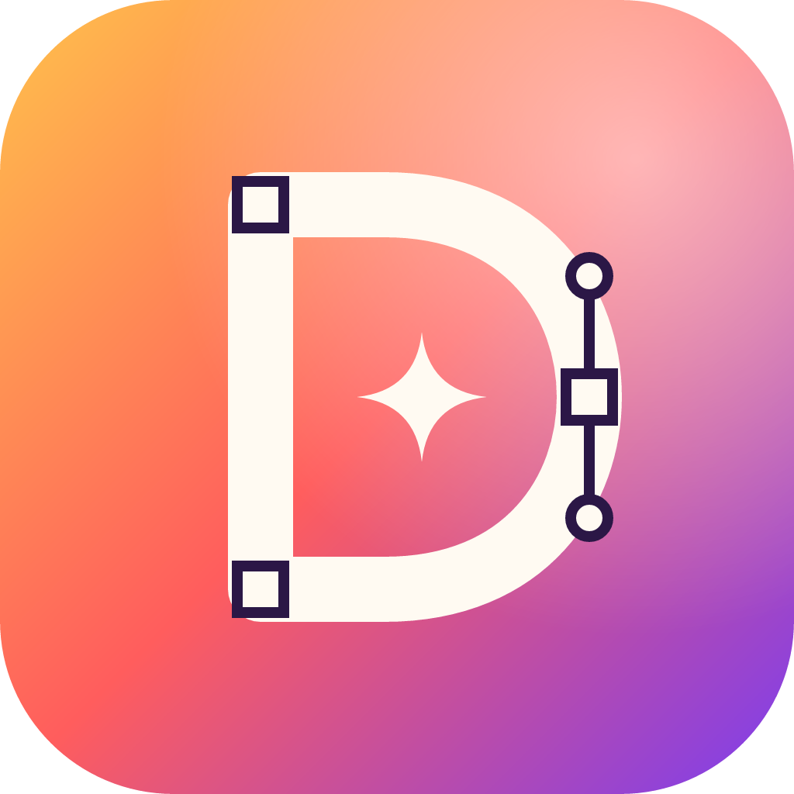

<p align="center">
  
</p>

<h1 align="center">DLightroom</h1>

<p align="center">
  <b>A native desktop vector illustration app for macOS, built in Rust on the open-source VectorCraft engine.</b>
</p>

<p align="center">
  <a href="#what-it-does">What it does</a> ·
  <a href="#install-on-a-mac">Install</a> ·
  <a href="#build-from-source">Build</a> ·
  <a href="#known-limitations">Limitations</a> ·
  <a href="#where-dlightroom-comes-from">Upstream</a> ·
  <a href="#license-and-credits">License</a>
</p>

DLightroom is a complete desktop graphics editor: an infinite canvas with artboards, Bézier pen and
shape tools, layers, type, gradients and colour management, live effects, and SVG, PDF and EPS
files. It is an independently branded build of
[VectorCraft](https://github.com/storytold/vectorcraft), an open-source (MIT OR Apache-2.0) vector
illustration workspace. DLightroom keeps VectorCraft's editing engine and user interface as they are,
and adds its own name, app icon, macOS bundle and build pipeline.

> **Status: alpha, unsigned test builds.** DLightroom builds come from GitHub Actions, ad-hoc
> signed, with no Apple Developer ID and no notarization. See [Known limitations](#known-limitations).

## What it does

Everything below comes from the VectorCraft engine and works in DLightroom unchanged:

- **Canvas and navigation:** multiple artboards, zoom and pan (trackpad, scroll, Hand and Zoom
  tools, Fit Artboard / Fit All), rulers, guides, grids, Smart Guides, Outline and Preview modes,
  light and dark themes, saved workspaces.
- **Drawing:** Pen, Curvature, Pencil, Paintbrush and Blob Brush, Line, Arc, Spiral, rectangular
  and polar grids, Rectangle, Rounded Rectangle, Ellipse, Polygon, Star, Shaper, Width and Dimension
  tools, Image Trace.
- **Selection and Bézier editing:** Selection, Direct Selection, Group Selection, Lasso and Magic
  Wand; add, delete and convert anchor points; edit handles; join, average, simplify, offset and
  outline paths; Live Corners; Free Transform, rotate, reflect, scale and shear.
- **Objects and layers:** a Layers panel with nested layers and sublayers, lock and visibility,
  groups, clipping masks, compound paths, Align and Distribute, Pathfinder and Shape Builder with
  exact curve booleans, Live Blends, Envelope Distort, Repeat, Perspective Grid, symbols.
- **Paint:** fills and strokes, Swatches and colour libraries, the Color and Color Guide panels,
  linear, radial and freeform gradients, Gradient Mesh, patterns, Appearance with multiple fills and
  strokes, transparency and blend modes, graphic styles, RGB and CMYK documents.
- **Type:** point, area and path type, character and paragraph styles, OpenType features, text
  threading, bidirectional (Hebrew and Arabic) layout, outlines.
- **Effects:** live vector effects (drop shadow, glow, distort and transform, 3D Revolve and more)
  and raster effects, editable from the Appearance panel.
- **Undo and history:** unlimited undo/redo, and Data Recovery after an unexpected quit.
- **Files:** open and save the native `.vectorcraft` document (and older `.drawcraft` files),
  templates (`.vctemplate`), SVG and SVGZ, PDF and PDF-compatible `.ai`, legacy `.ai` version 7,
  EPS, DXF, EMF/WMF, PNG, JPEG, WebP, GIF, TIFF and BMP, and Affinity documents as read-only imports.
  Exports include PNG, JPEG, WebP, TIFF, GIF, SVG, PDF (with presets and PDF/X), EPS, PSD, Export
  for Screens, Save for Web, Package and Print.
- **Automation:** every menu item and tool is a command that a JSON control channel
  (`--control <port>`) and an MCP server (`vectorcraft-cli mcp`) can run, plus a headless
  command-line tool for conversion and batch work (`vectorcraft-cli`).
- **Languages:** the interface is translated into 19 languages besides English.

For details of what is and isn't implemented yet, read the upstream assessments kept in this
repository: [`ROADMAP.md`](ROADMAP.md), [`docs/gaps.md`](docs/gaps.md) and
[`docs/target-app-parity.md`](docs/target-app-parity.md). They describe the VectorCraft engine,
which DLightroom inherits unchanged.

## Install on a Mac

Requirements: macOS 11 Big Sur or later. Builds are tested for Intel Macs, for example a 2019
MacBook Pro on macOS Sequoia 15.

1. Open the repository's **Actions** tab, choose the latest successful
   **macOS Intel (DLightroom.app)** run, and download the **DLightroom-macos-x86_64** artifact.
2. Unzip the download. Inside is `DLightroom-<version>-macos-x86_64.zip`; unzip that too (double-click
   it in Finder) to get **DLightroom.app**.
3. Drag **DLightroom.app** into **Applications**.
4. The app isn't notarized, so Gatekeeper blocks the first start. Either:
   - double-click DLightroom, choose **Done**, then open **System Settings › Privacy & Security**,
     scroll to *"DLightroom" was blocked…*, click **Open Anyway** and confirm; or
   - in Terminal, remove the quarantine flag once:
     ```sh
     xattr -dr com.apple.quarantine /Applications/DLightroom.app
     ```

DLightroom keeps its settings in `~/Library/Application Support/DLightroom`. On its first start it
copies any existing VectorCraft (or older DrawCraft) preferences from their folders. It never writes
to them, so DLightroom and VectorCraft can be installed side by side. The bundle also holds the
command-line tool, at `/Applications/DLightroom.app/Contents/MacOS/vectorcraft-cli`.

## Build from source

### Prerequisites (macOS, Intel or Apple silicon)

- **Xcode 16.4** from the App Store, or just its command-line tools (`xcode-select --install`).
  Select it with `sudo xcode-select -s /Applications/Xcode.app/Contents/Developer` and accept the
  licence with `sudo xcodebuild -license accept`.
- **Rust**, stable channel, 1.95 or newer, through [rustup](https://rustup.rs):
  ```sh
  curl --proto '=https' --tlsv1.2 -sSf https://sh.rustup.rs | sh
  rustup target add x86_64-apple-darwin      # already the default on an Intel Mac
  ```
- About 15 GB of free disk space for the build.

### Build and run

```sh
git clone https://github.com/dangelolane11/dlightroom
cd dlightroom

cargo run --release -p vectorcraft                                   # run DLightroom from source
cargo run --release -p vectorcraft -- examples/dusk-poster.vectorcraft

packaging/macos/build-app.sh --arch x86_64                           # DLightroom.app + ZIP for Intel Macs
open target/macos-app/DLightroom.app
```

`build-app.sh` builds the release binaries, assembles `target/macos-app/DLightroom.app` (with the
app icon, `Info.plist` and licence files), ad-hoc signs it, runs smoke tests (version, usage, and
rendering the examples to PNG and PDF), and writes
`dist/release/DLightroom-<version>-macos-x86_64.zip`. Use `--arch aarch64` for Apple silicon, or
`--arch universal` for both (run `rustup target add aarch64-apple-darwin x86_64-apple-darwin`
first). To install your own build, copy `target/macos-app/DLightroom.app` into `/Applications`.

Package, crate and binary names keep their upstream `vectorcraft` names on purpose (see
[Where DLightroom comes from](#where-dlightroom-comes-from)). So the desktop binary is
`vectorcraft` and the command-line tool is `vectorcraft-cli`.

### Checks

```sh
cargo test -p vectorcraft -p xtask          # app, bundle and branding tests (fast)
cargo test --workspace                      # everything (slow; the engine has thousands of tests)
cargo xtask ci                              # fmt, clippy (no panics), tests, layering, wasm, assets, vendor names
```

The [macOS Intel workflow](.github/workflows/macos-intel.yml) runs on every push to `main` and on
every pull request, on GitHub's `macos-15-intel` runner with Xcode 16.4. It runs the app and
packaging tests, builds DLightroom.app, checks that it is an x86_64 binary, and uploads the ZIP. It
needs no secrets or signing credentials.

Other entry points from upstream still work: the web build (`cd apps/vectorcraft-web && trunk
build --release`), `cargo xtask bundle` (a development `dist/DLightroom.app`), and the signed release
script `packaging/macos/package.sh`, which needs your own Developer ID (see below).

## Known limitations

- **Unsigned.** The app is ad-hoc signed only, with no Developer ID and no notarization, so
  Gatekeeper asks before the first start (see [Install](#install-on-a-mac)). Signing and notarizing
  need a paid Apple Developer Program membership. `packaging/macos/package.sh` does both when given
  `MACOS_SIGN_IDENTITY`, `APPLE_ID`, `APPLE_PASSWORD` and `APPLE_TEAM_ID`.
- **Temporary bundle identifier.** `com.dangelolane11.dlightroom.dev` is for local testing; choose
  a permanent one (in `packaging/macos/Info.plist.in` and `crates/engine/src/brand.rs`) before any
  public release.
- **Intel build only in CI.** The workflow builds x86_64. An Apple silicon or universal build works
  with `build-app.sh --arch aarch64|universal`, but CI doesn't run one.
- **The name.** "Lightroom" is a trademark of Adobe Inc. DLightroom is a vector editor and has no
  connection to Adobe. Before distributing DLightroom publicly, check the name with a trademark
  professional.
- **Upstream names that remain on purpose:** the native file format and its labels (`.vectorcraft`,
  "VectorCraft Document", "VectorCraft Template"), built-in preset names saved in user files ("VectorCraft
  Default" PDF preset, "VectorCraft Defaults" shortcuts, "VectorCraft Generic CMYK"), file metadata
  (PDF and SVG generator fields, EPS markers), crate and binary names, the control and MCP protocols,
  and `VECTORCRAFT_*` environment variables. Renaming them would break compatibility with existing
  documents and scripts.
- **Not yet rebranded:** the Windows installer (`packaging/windows`), the Linux packages and their
  `ai.storyteller.vectorcraft` desktop id (only their display names changed), the web build's
  internal names, and the upstream engineering docs under `docs/` and `ROADMAP.md`. Those docs still
  describe the project as VectorCraft, and their screenshots (`docs/images`) show the upstream UI.
- **Fonts:** CI builds without the optional [craft-fonts](https://github.com/storytold/craft-fonts)
  bundle, so Japanese, Chinese and Arabic text uses the fonts installed on the Mac.
- **Feature gaps** are inherited from the engine. It is alpha software, and the upstream
  [`docs/gaps.md`](docs/gaps.md) lists what is missing.
- **Upstream workflows** that depend on the upstream organization's shared workflows, test corpora or
  signing secrets (FreeBSD, Windows, Affinity corpus, signed release) run only by hand
  (`workflow_dispatch`).

## Where DLightroom comes from

DLightroom is a fork of [**VectorCraft**](https://github.com/storytold/vectorcraft) v0.12.0 by the
ArtCraft Team and the VectorCraft contributors. Nearly all of the code (the geometry, rendering,
document, file-format, effects and type engines, the egui user interface, the tools and the tests)
is theirs, used under its MIT OR Apache-2.0 licence. The git history keeps their authorship.

DLightroom's own changes:

- the product name in the window, the menus (including the macOS app menu), the About box, dialogs
  and messages, in all 20 interface languages (`crates/engine/src/brand.rs` holds the name);
- an original app icon (`assets/app-icon/dlightroom.svg`) in place of upstream's ArtCraft-drawn
  icon;
- Help links to this repository and to upstream VectorCraft, instead of upstream's community links;
- its own preferences folder, and a macOS bundle (`DLightroom.app`, with its own bundle identifier)
  that still opens VectorCraft documents;
- the unsigned macOS build script and the Intel macOS GitHub Actions workflow;
- the removal of the ArtCraft logos, as the upstream brand licence
  ([`docs/brand/LICENSE-brand.txt`](docs/brand/LICENSE-brand.txt)) requires of modified versions.

DLightroom is not made, sponsored or endorsed by the ArtCraft Team, and it is not affiliated with
Adobe. Upstream's clean-room rules still apply to all work here: no Adobe software, code, assets or
iconography. See [`AGENTS.md`](AGENTS.md).

## License and credits

DLightroom, like VectorCraft, is dual-licensed under [MIT](LICENSE-MIT) or
[Apache-2.0](LICENSE-APACHE), at your option. Copyright (c) 2026 ArtCraft Team and the VectorCraft
contributors, and the DLightroom contributors for their changes. The required notices, including
upstream's, are in [NOTICE](NOTICE).

Bundled fonts, icons and other assets keep their own open licences. Each one is listed with its
author, source and licence in [ASSETS.md](ASSETS.md); their licence texts sit next to them and in
[`licenses/`](licenses), and the macOS app carries all of them in `Contents/Resources`.

<sub>Adobe, Illustrator and Lightroom are trademarks or registered trademarks of Adobe Inc. in the United States and/or other countries. DLightroom is an independent, open-source project and is not affiliated with, sponsored by or endorsed by Adobe Inc.</sub>
